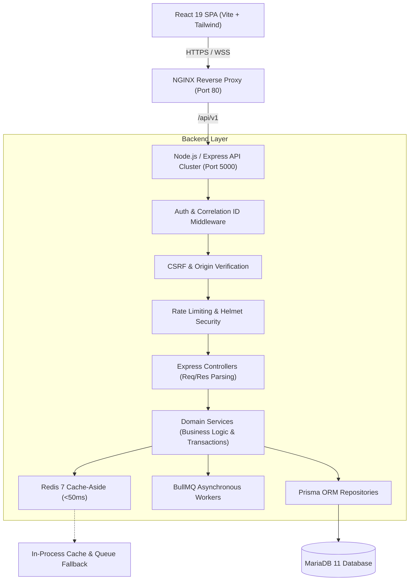

# ⬡ Syntrix — Enterprise Multi-Tenant Agile & Collaboration Platform

[](.github/workflows/ci.yml)
[](backend/src/__tests__)
[](tsconfig.json)
[](frontend/)
[](backend/)
[](backend/prisma/)
[](docker-compose.yml)
[](backend/src/config/redis.config.ts)
[](Dockerfile)
[](LICENSE)

Syntrix is an enterprise-grade, multi-tenant collaboration and agile project management platform designed for engineering, product, and operations teams. Built with a 6-tier MVC + Service Layer architecture, it features real-time 60fps drag-and-drop Kanban boards, sprint burndown analytics, DAG dependency cycle prevention, deep binary file upload scanning, and Redis cache-aside query pipelines with sub-50ms execution SLAs.

---

## 🌟 Key Features

- **Multi-Tenant Workspaces & RBAC**: Strict tenant isolation across organizations with granular roles (`OWNER`, `ADMIN`, `MANAGER`, `MEMBER`, `GUEST`).
- **Interactive Kanban Boards**: Native 60fps drag-and-drop task manipulation with optimistic UI updates, auto-rollbacks, and grab animations.
- **Sprint Management & Burndown Analytics**: Agile iteration cycles, single active sprint invariants, automated task rollover, and dynamic SVG burndown curves.
- **DAG Task Dependency Engine**: Directed Acyclic Graph relationships (`BLOCKS`, `BLOCKED_BY`, `RELATES_TO`) with recursive cycle detection.
- **Enterprise Security Hardening**: JWT family refresh token rotation with reuse detection, Helmet HTTP headers, CORS origin verification, path-traversal sanitization, and binary magic-byte file validation.
- **High-Performance Architecture**: Compound database indexing, cursor-based seek pagination, Gzip response compression, and resilient Redis caching with in-process fallbacks.
- **Threaded Discussions & In-App Notifications**: Infinite comment nesting with `@mention` parsing, activity audit trails, and real-time alert bells.
- **Contemporary Warm Sand UI**: Handcrafted design system featuring Bone White (`#F5F3EB`), Warm Amber (`#F5AE4D`), Charcoal typography (`#20201D`), and micro-interactions.

---

## 🏛️ System Architecture



---

## 📁 Repository Structure

```
d:/Syntrix/
├── backend/                  # Node.js Express & TypeScript API
│   ├── prisma/               # Prisma Schema & Database Seeders
│   ├── src/
│   │   ├── config/           # Prisma, Redis, Swagger & Environment Configs
│   │   ├── controllers/      # HTTP Request/Response Controllers
│   │   ├── middleware/       # Auth, Security, CSRF, Rate Limiting, Uploads
│   │   ├── repositories/     # Data Access Layer (Prisma Queries)
│   │   ├── routes/           # Express Route Definitions
│   │   ├── services/         # Business Logic & Transaction Orchestration
│   │   ├── utils/            # Magic Bytes, Error Handling, Tracing
│   │   └── __tests__/        # Vitest Automated Test & Benchmark Suites
│   └── Dockerfile            # Multi-stage production backend container
│
├── frontend/                 # React 19 SPA with Vite & TypeScript
│   ├── src/
│   │   ├── components/       # Modals, Drawers, Layouts, Charts, Primitives
│   │   ├── context/          # Auth, Organization, Theme State Providers
│   │   ├── pages/            # Kanban Board, Sprints, Analytics, Teams, Auth
│   │   └── services/         # Axios API Client with Token Interceptors
│   ├── nginx.conf            # Production SPA NGINX configuration
│   └── Dockerfile            # Multi-stage production frontend container
│
├── docs/                     # Specifications & Portfolio Guides
│   ├── PRD.md                # Product Requirements Document
│   ├── SRS.md                # Software Requirements Specification
│   ├── DATABASE_DESIGN.md    # ERDs & Database Schema Design
│   └── PORTFOLIO_SHOWCASE.md # Resume Highlights & Technical Interview Q&A
│
├── notes/                    # Modular Architecture & ADR Records
│   ├── README.md             # Documentation Index
│   ├── architecture.md       # Layered Architecture Deep Dive
│   ├── decisions.md          # Architecture Decision Records (ADRs)
│   └── modules/              # Domain-Specific Module Notes
│
├── nginx/                    # Production Reverse Proxy Configurations
├── scripts/                  # Database Backup & Restore Automation Scripts
└── docker-compose.yml        # Multi-Container Production Orchestration
```

---

## ⚡ Quickstart & Development

### 1. Prerequisites
- **Node.js**: v20.x or v22.x LTS
- **MariaDB / MySQL**: v10.11+ / v8.0+
- **Redis**: v7.x (Optional — in-process fallback runs automatically)

### 2. Local Infrastructure with Docker
```bash
# Start local MariaDB and Redis containers
docker compose -f docker-compose.dev.yml up -d
```

### 3. Install Dependencies
```bash
# Install all root, backend, and frontend dependencies
npm install
```

### 4. Setup Database & Seed Multi-Tenant Data
```bash
cd backend
npx prisma generate
npx prisma db push
npx tsx prisma/seed-all.ts
```

### 5. Run Development Servers
```bash
# In terminal 1 (Backend API on http://localhost:5000)
cd backend && npm run dev

# In terminal 2 (Frontend SPA on http://localhost:5173)
cd frontend && npm run dev
```

### 6. Interactive Swagger Documentation
Explore the interactive OpenAPI documentation at:  
👉 **`http://localhost:5000/api-docs`**

---

## 🧪 Testing Matrix

Syntrix includes unit tests, integration assertions, component testing, security penetration evaluations, and latency benchmarks:

```bash
# Run all test suites across the monorepo
npm test

# Output:
# ✓ 27 passed tests across 8 test suites in <2.2s
```

---

## 🐳 Full Stack Docker Deployment

Launch the entire stack (MariaDB, Redis, Backend API, Frontend NGINX) with a single command:

```bash
docker compose up --build -d
```

Access the application at: **`http://localhost`**

---

## 📄 License
This project is licensed under the MIT License — see the [LICENSE](LICENSE) file for details.
