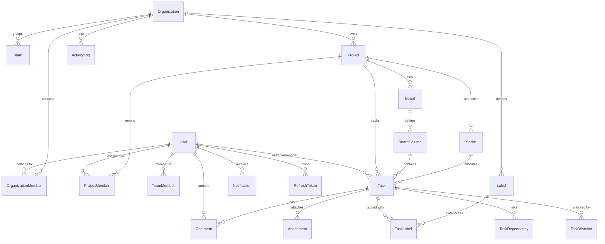

# Syntrix — Database Design Document & ERD

## 1. High-Level Entity Relationship Diagram (ERD)

---

## 2. Core Tables & Indexing Strategy

### 2.1 `User` & `RefreshToken`
- `User`: Primary identity table (`id`, `email UNIQUE`, `password`, `role`, `avatarUrl`).
- `RefreshToken`: Stored hashed refresh tokens (`token UNIQUE`, `userId`, `expiresAt`, `isRevoked`).

### 2.2 `Organization`, `OrganizationMember`, `Team`, `TeamMember`
- `Organization`: Workspace tenant root (`id`, `slug UNIQUE`, `name`, `logoUrl`).
- `OrganizationMember`: Composite unique `[organizationId, userId]`, role enum (`OWNER`, `ADMIN`, `MANAGER`, `MEMBER`, `GUEST`).
- `Team`: Sub-tenant team structures (`[organizationId, name]`).

### 2.3 `Project`, `Board`, `BoardColumn`, `Sprint`
- `Project`: Project workspaces with unique key per org `[organizationId, key]`, status index `[organizationId, status]`.
- `Board`: Kanban boards partitioned by project `[projectId]`.
- `BoardColumn`: Workflow columns indexed on `[boardId, position]`.
- `Sprint`: Iteration cycles indexed on `[projectId, status]`.

### 2.4 `Task`, `TaskLabel`, `TaskDependency`, `TaskWatcher`
- `Task`: Central work items indexed on:
  - `@@unique([projectId, number])`
  - `@@index([projectId, status])`
  - `@@index([projectId, createdAt])`
  - `@@index([assigneeId, status])`
  - `@@index([sprintId, status])`
  - `@@index([columnId, position])`
- `TaskDependency`: Directed relationship links with cycle prevention `[taskId, dependsOnTaskId, type]`.

### 2.5 `Comment`, `ActivityLog`, `Attachment`, `Notification`
- `Comment`: Nested threaded discussions indexed on `[taskId, createdAt]` and `[parentId]`.
- `ActivityLog`: Audit trail indexed on `[taskId, createdAt]`, `[projectId, createdAt]`, and `[organizationId, createdAt]`.
- `Attachment`: File uploads indexed on `[taskId, createdAt]`, `[projectId, createdAt]`, and `[organizationId, createdAt]`.
- `Notification`: In-app notifications indexed on `[userId, isRead, createdAt]`.
